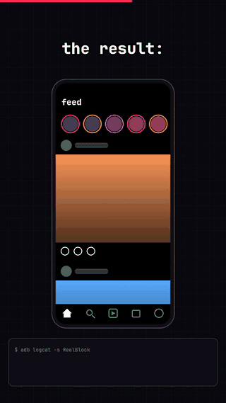

https://github.com/user-attachments/assets/f1849b19-d0a4-4125-94d2-c3a2c4e31fba

<p align="center">
  
</p>

<h1 align="center">Reel Block</h1>

<p align="center"><b>Keep Instagram and YouTube. Lose the Reels and Shorts.</b></p>

<p align="center">
  Reel Block is a free, open-source Android app that closes Instagram Reels and YouTube Shorts
  the moment they open, and keeps everything else in those apps.
</p>

<p align="center">
  <a href="../../releases/latest"><b>⬇ Download the APK</b></a> ·
  <a href="#install-in-2-minutes">Install</a> ·
  <a href="#faq">FAQ</a> ·
  <a href="CONTRIBUTING.md">Add an app</a>
</p>

<p align="center">
  
  <br>
  <sub>▶ <a href="https://github.com/SuzalShrestha/reelblock/raw/main/docs/demo.mp4">Download the 40-second story</a> (MP4, 4.5 MB) of how we found the Reels screen inside Instagram</sub>
</p>

---

## Why

You open Instagram to answer one message. Forty minutes later you are still swiping Reels.
That is not a lack of willpower. The feed is built to never end.

Most blockers lock the whole app. Then you lose your DMs, your friends' Stories and the
YouTube tutorial you actually needed, so you turn the blocker off. Reel Block removes only
the endless short-video feed. Everything else stays.

| | Reel Block |
|---|---|
| Instagram Reels tab | **Closed** |
| Reels opened from DMs, Explore or a profile | **Closed** (same viewer, not tested yet) |
| YouTube Shorts tab and Shorts links | **Closed** |
| Instagram feed, Stories, DMs, profiles, posting | Works |
| YouTube home, search, normal videos, subscriptions | Works |
| Root, modified APKs, accounts, ads, tracking | **None** |
| Size | About 20 KB |

## How it feels

You tap the Reels tab. You are back on your feed before the first Reel plays.
You tap a Shorts link from a friend. YouTube closes.
After a few days you stop reaching for it, because nothing is there.

Open the app to see how many Reels and Shorts it closed for you, and share the number.

## Install in 2 minutes

1. **Download** `ReelBlock.apk` from the [latest release](../../releases/latest) on your phone and open it.
   If Android asks, allow your browser or file manager to install apps.
2. **Open Reel Block** from your app list and tap **Turn on Reel Block**.
3. In the Accessibility list, tap **Reel Block** (it can be under *Downloaded apps* or
   *Installed services*) and turn it on.

That is all. Open Instagram and tap the Reels tab to test it.

**The switch is grey or says "Restricted setting"?** Android 13 and later lock this setting for
apps that are not from an app store. In Reel Block, tap **Open app info**, then **⋮ → Allow
restricted settings**, then go back to step 3.

**Xiaomi, Redmi, POCO (HyperOS, MIUI), Samsung, OnePlus, Oppo, Vivo:** if Reels come back after
some hours, the phone stopped the service to save battery. In **Settings → Apps → Reel Block**,
turn on **Autostart** (if you see it) and set battery use to **No restrictions / Unrestricted**.

**To stop:** turn off the service in Accessibility settings, or uninstall the app.

## FAQ

**Is it safe? Accessibility apps can read my screen.**
Yes, Android gives accessibility apps a lot of access. That is why Reel Block is open source and
very small: [the service is about 40 lines](src/dev/local/reelblock/ReelBlockService.java) and the
[app screen is about 80](src/dev/local/reelblock/MainActivity.java). Read them. The app:
- listens only to Instagram and YouTube (see [`accessibility.xml`](res/xml/accessibility.xml)),
- looks for one view ID per app and reads no text, messages or images,
- has **no internet permission** (see [`AndroidManifest.xml`](AndroidManifest.xml)), so it cannot send
  anything anywhere,
- stores one number on your phone: how many times it closed a viewer.

**Why is it not on the Play Store?**
Google allows accessibility apps on the Play Store only for some uses. You can build the APK
yourself from this source (see below) and compare.

**Does it work on iPhone?**
No. iOS does not let apps act on other apps. On iPhone, the closest option is a Screen Time limit
on the whole app.

**Can I block only Reels and keep Shorts (or the opposite)?**
Not yet in the app. Remove the line you do not want from `VIEWERS` in
[`ReelBlockService.java`](src/dev/local/reelblock/ReelBlockService.java) and build it.
A switch in the app is a good first contribution.

**What about Facebook Reels, TikTok, Snapchat Spotlight?**
TikTok is only short videos, so uninstall it. For the others, [add the app](CONTRIBUTING.md):
it is one line of code if the app uses view IDs.

**Short videos still play inside my Instagram feed.**
Yes. Reel Block closes the full-screen viewer, which is the endless part. A video in the feed
stops when you scroll past it.

**Reels came back after an Instagram or YouTube update.**
The app maybe changed its view ID. [Open an issue](../../issues/new?template=id-changed.md)
with your app version. Fixes are one line, see [CONTRIBUTING.md](CONTRIBUTING.md).

## How it works

Reel Block is an Android accessibility service. When Instagram or YouTube changes its screen, the
service looks for a visible full-screen short-video viewer by its view ID. If it finds one, it
presses Back.

| App | Viewer ID | How we found it |
|---|---|---|
| Instagram 453.0.0.57.79 | `clips_viewer_view_pager` | `aapt2 dump resources` on the APK, then `dumpsys activity top` with Reels open. Inside Instagram, Reels are called *clips*; `reel_*` IDs are Stories. |
| YouTube | `reel_recycler` | `dumpsys activity top` with Shorts open: a full-screen `ReelRecyclerView`. It is not on the home feed. Inside YouTube, Shorts are called *reels*. |

After each Back press the service waits 1.5 seconds, so one Back does not become two while the app
closes. Each press writes a log line:

```sh
adb logcat -s ReelBlock:I
# I ReelBlock: Viewer visible, pressing Back: com.google.android.youtube:id/reel_recycler
```

## Build from source

You need a JDK (11 or later) and the Android SDK with one `build-tools` and one `platforms`
package. No Gradle and no Android Studio. The build takes a few seconds.

```sh
./build.sh                # build ReelBlock.apk and install it with adb
./build.sh <serial>       # pick a device when more than one is connected
NO_INSTALL=1 ./build.sh   # build only
```

The script uses `$ANDROID_HOME` (default `~/Library/Android/sdk`) and picks the newest build-tools
and platform. Set `BUILD_TOOLS=/path/to/build-tools/<version>` or `ANDROID_JAR=/path/to/android.jar`
to choose others. On the first build it creates a local `debug.keystore` to sign the APK. Git ignores
this file. GitHub Actions builds every push, see [`.github/workflows/build.yml`](.github/workflows/build.yml).

## Spread it

If Reel Block gave you some time back, send it to one friend who needs it.
The **Share** button in the app writes the message for you. A ⭐ on GitHub also helps other people
find it.

## Contributing

New apps, fixed IDs, translations and test reports on more phones are all welcome.
See [CONTRIBUTING.md](CONTRIBUTING.md).

## Disclaimer

This project is not affiliated with Instagram, Meta, YouTube or Google. Instagram is a trademark of
Meta Platforms, Inc. YouTube is a trademark of Google LLC.

## License

[MIT](LICENSE)
