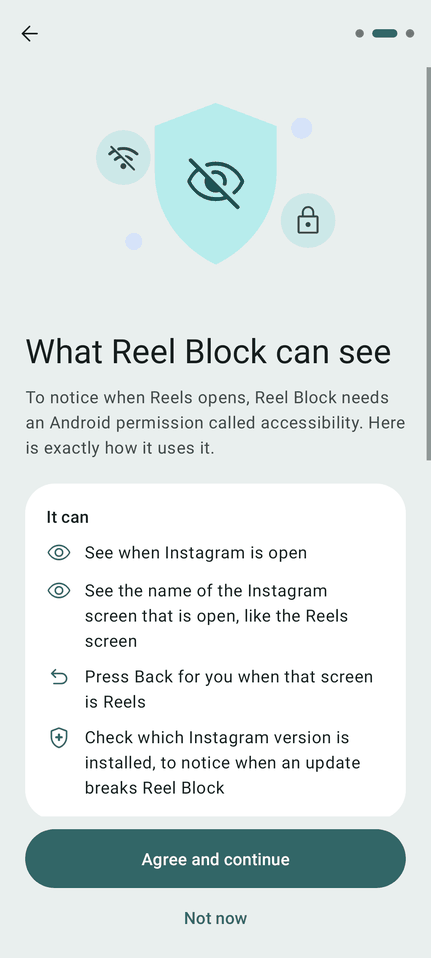
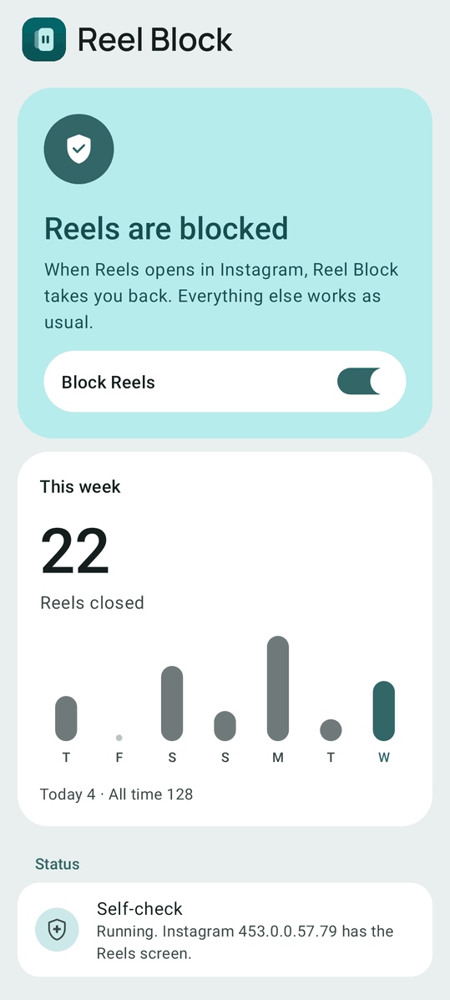
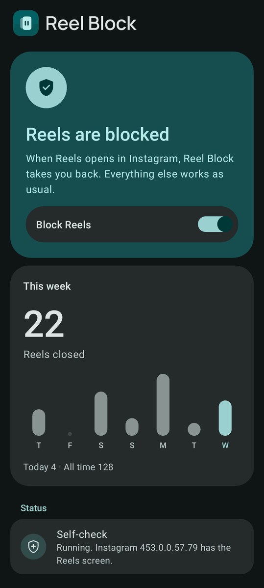
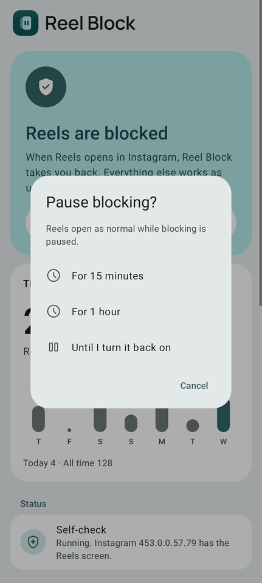

<p align="center">
  
</p>

<h1 align="center">Reel Block</h1>

<p align="center"><b>Keep Instagram. Lose the Reels.</b></p>

<p align="center">
  Reel Block is a free, open-source Android app that closes Instagram Reels
  the moment they open, and keeps everything else in Instagram.
</p>

<p align="center">
  <a href="../../releases/latest"><b>⬇ Download the APK</b></a> ·
  <a href="#install-in-2-minutes">Install</a> ·
  <a href="#faq">FAQ</a>
</p>

https://github.com/user-attachments/assets/9e368622-f6dc-417e-a583-c22226c2a839

<p align="center">
  
  
  
  
</p>

These screenshots are rendered from the real layouts with Robolectric native graphics. They are not taken
on a phone. On Android 12 and later the colours follow your wallpaper, so your phone may look different.
The full set (every state, dark mode, font scale 2.0, right-to-left, a small screen and Android 14) is in
[`docs/screens/`](docs/screens). The audits [`audit-android11.txt`](docs/screens/audit-android11.txt) and
[`audit-android14.txt`](docs/screens/audit-android14.txt) show that every clickable view has a label and is at
least 48dp, rendered with Robolectric.

---

## What's new in 2.0

- **A new look.** Material 3, a calm teal brand, dark mode, and a new icon. On Android 12 and later
  it follows your wallpaper colours. See [Design](#design).
- **A first run that tells you what it can see.** Before Android settings open, a screen has three
  cards: what Reel Block can do, what it keeps (only on your phone), and what it never does. Settings open
  only after you tap **Agree and continue**. You can read the screen again from the home screen.
- **One clear status on the home screen.** Reels are blocked, paused, off, stopped by Android, or
  Instagram has changed, each with one main action.
- **A "This week" chart.** Reels closed per day, plus today and all-time counts. They stay on your phone.
- **Self-check.** It tells you when Android stopped Reel Block, when an Instagram update removed the
  Reels screen it looks for, and when it cannot tell.
- **A Quick Settings tile.** Pause or resume from the top of your screen. Pausing asks for how long.
- **Still the same promises.** Instagram only, no permission at all, no logs, no analytics, no account.
  The APK grew from about 30 KB to about 100 KB because of the design system, vector icons and
  illustrations, and dynamic colour.

---

## Why

You open Instagram to answer one message. Forty minutes later you are still swiping Reels.
That is not a lack of willpower. The feed is built to never end.

Most blockers lock the whole app. Then you lose your DMs, and your friends' Stories, so you
turn the blocker off. Reel Block removes only the endless Reels feed. Everything else stays.

| | Reel Block |
|---|---|
| Instagram Reels tab | **Closed** |
| Reels opened from DMs, Explore or a profile | **Closed** (same viewer, not tested yet) |
| Instagram feed, Stories, DMs, profiles, posting | Works |
| Other apps | **Never touched**. Reel Block listens only to Instagram |
| Root, modified APKs, accounts, ads, tracking, logs | **None** |
| Quick Settings tile | Pause (asks for how long) or resume |
| Self-check | Tells you when Android stopped it or Instagram changed |
| Size | About 100 KB |

## How it feels

You tap the Reels tab. You are back on your feed before the first Reel plays.
After a few days you stop reaching for it, because nothing is there.

Open the app to see how many Reels it closed for you, today and this week, and share the number.

## Install in 2 minutes

1. **Download** `ReelBlock.apk` from the [latest release](../../releases/latest) on your phone and open it.
   If Android asks, allow your browser or file manager to install apps. It is signed with the same
   key as older releases, so it upgrades them.
2. **Open Reel Block** from your app list and tap **Get started**. Read **What Reel Block can see**,
   then tap **Agree and continue**. (**Not now** goes to the home screen, with Reel Block off. Reel Block
   remembers it and does not bring the first run back by itself. To start again, tap **Turn on Reel Block**
   on the home screen. It shows the disclosure again if you never agreed.)
3. Tap **Open settings**. In the Accessibility list, find **Reel Block** (it can be under
   *Downloaded apps* or *Installed apps*), turn it on, and tap **Allow**.

That is all. Open Instagram and tap the Reels tab to test it. Reel Block does not send you to Android's
Accessibility settings to turn it on before you tap **Agree and continue**. You can read **What Reel Block
can see** again any time: on the home screen, under **Private by design**. Then the button says **Next**,
because you already agreed.

**The switch is grey or says "Restricted setting"?** Android 13 and later lock this setting for
apps that are not from an app store. On Android 13 and later, page 3 shows this help under the steps. Reel Block
does not try to detect whether you need it. Tap **Open App info**, then **⋮ → Allow
restricted settings**, then go back and try step 3 again. The same help is under **Setup help** on the home screen.

**Xiaomi, Redmi, POCO (HyperOS, MIUI), Samsung, OnePlus, Oppo, Vivo:** if Reels come back after
some hours, the phone stopped the service to save battery. In **Settings → Apps → Reel Block**,
turn on **Autostart** (if you see it) and set battery use to **No restrictions / Unrestricted**.
On Xiaomi phones, swiping Reel Block away in Recents also stops it ("Not working" in Accessibility
settings). The app leaves no Recents card when you leave it. With **Autostart** on, the
phone starts it again in about 1 second, even after a swipe. On Xiaomi phones only, the home screen shows
a **Keep it running** row that opens Autostart. If Android still stops Reel Block, the home screen says
**Android stopped Reel Block** and the self-check says "Not running". Turn it off and on again in
Accessibility settings.

**To pause:** open Reel Block and turn off the "Block Reels" switch, or tap the Reel Block
**Quick Settings tile** while it is blocking. Both ask for how long: **15 minutes**, **1 hour** or
**Until I turn it back on**. Back or Cancel keeps blocking on. A timed pause ends by itself, so you cannot
forget to turn blocking on again. To resume early, turn the switch on again, or tap the tile while it shows
Paused or "Until" a time. If Android stopped Reel Block, the tile says **Not running**, and tapping it opens the app.

**To add the tile:** on Android 13 and later, tap the **Quick Settings tile** row on the home screen and
Android offers to add it. If it is already there, the app tells you. On older versions, swipe down twice from
the top, tap the pencil, and drag Reel Block in.

**To stop:** turn off the service in Accessibility settings, or uninstall the app.

### Verify the APK

Releases are signed with one key. Check it before you install:

```sh
apksigner verify --print-certs ReelBlock.apk
```

The output must show this line:

```
certificate SHA-256 digest: 7c30d87c9351ad58ed3ec783ebf29bb3f21595d1d08447690f4633dfa0310981
```

That is the `CERT` value in [`release.sh`](release.sh), which refuses to publish an APK signed with another key.
Each release also lists the APK's SHA-256 in its notes. Compare it with `sha256sum ReelBlock.apk`
(`shasum -a 256 ReelBlock.apk` on macOS). An APK you build yourself is signed with your own key, so its
digest is different.

Note on Android developer verification: from 2027 Google plans to require registered developers for app
installs on certified devices. Sideloads from GitHub are not affected yet
([Google's FAQ](https://developer.android.com/developer-verification/guides/faq)).
The maintainer should register before 2027.

## FAQ

**Is it safe? Accessibility apps can read my screen.**
Yes, Android gives accessibility apps a lot of access. That is why Reel Block is open source and
very small: [the part that acts on Instagram is 56 lines](src/dev/local/reelblock/ReelBlockService.java),
and the whole app is about 910 lines of Java in [8 files](src/dev/local/reelblock). Read them. The app:
- listens only to Instagram (see [`accessibility.xml`](res/xml/accessibility.xml)), and the code
  checks the package again before it looks at any window,
- looks for one view ID and reads no text, messages or images,
- has **no permission at all** and no internet permission (see [`AndroidManifest.xml`](AndroidManifest.xml)),
  so it cannot send anything anywhere. `aapt2 dump badging ReelBlock.apk` lists none,
- writes no logs,
- stores these things on your phone, in two private files: your pause setting (and when a timed pause
  ends), whether you agreed to the disclosure or tapped **Not now**, the all-time count of closed Reels, and
  the count for each of the last 30 days. It stores no time of day for a close. Backup and phone-to-phone
  transfer copy nothing, so it stays on this phone,
- has one `<queries>` entry for `com.instagram.android` in the manifest. That is package visibility,
  not a permission. The [self-check](src/dev/local/reelblock/Check.java) uses it to read Instagram's
  version and to ask whether Instagram still has the view name `clips_viewer_view_pager`. It never looks at
  Instagram's screen for this. It keeps the answer in memory while the app runs, not on disk.

**Why is it not on the Play Store?**
Google allows accessibility apps on the Play Store only for some uses. You can build the APK
yourself from this source (see below) and compare.

**Does it work on iPhone?**
No. iOS does not let apps act on other apps. On iPhone, the closest option is a Screen Time limit
on the whole app.

**What about YouTube Shorts, Facebook Reels, TikTok?**
Reel Block is Instagram only, on purpose: the fewer apps an accessibility service can see, the
less it can leak. Use a separate app for the others.

**Short videos still play inside my Instagram feed.**
Yes. Reel Block closes the full-screen viewer, which is the endless part. A video in the feed
stops when you scroll past it.

**Reels came back after an Instagram update.**
Instagram maybe changed its view ID. Open Reel Block: if the home screen says **Instagram has changed**,
the self-check could not find the Reels view name any more. [Open an issue](../../issues/new?template=id-changed.md)
with your app version. Fixes are one line, see [CONTRIBUTING.md](CONTRIBUTING.md). If the self-check says it
"could not read Instagram right now", it cannot tell. Try again later.

## How it works

Reel Block is an Android accessibility service. When Instagram changes its screen, the
service looks for the visible full-screen Reels viewer by its view ID. If it finds one, it
presses Back.

| App | Viewer ID | How we found it |
|---|---|---|
| Instagram 453.0.0.57.79 | `clips_viewer_view_pager` | `aapt2 dump resources` on the APK, then `dumpsys activity top` with Reels open. Inside Instagram, Reels are called *clips*; `reel_*` IDs are Stories. |

After each Back press the service waits 1.5 seconds, so one Back does not become two while the app
closes. It writes no log lines. To check it, watch the counter in the app go up.

The **self-check** in the app is separate from the service. It checks that Android really runs the service
(not only that Settings shows it as on), and that the installed Instagram still has the view name above.
It ends in one of six results:

| Result | What the self-check line says |
|---|---|
| Running, Reels screen found | Running. Instagram *version* has the Reels screen. |
| Off | Off. Turn it on to start. |
| Stopped | Not running. Android stopped it. |
| Changed | Reels screen not found in Instagram *version*. |
| No Instagram | Instagram is not installed. |
| Cannot tell | Running. Could not read Instagram *version* right now. Try again later. |

"Cannot tell" appears when Android does not let the app read Instagram's package (for example while Instagram
updates). Reel Block says so, and does not guess "changed".

**Why the view name is a good test.** The service finds the Reels viewer by the same name. If Instagram's
resource table (the list of view names in its app) no longer has the name, the service cannot find the viewer
either, so Reels would stay open. The self-check asks the same question, before you notice. Loading
Instagram's resource table takes a moment, so it is read once per Instagram install or update (Android tells
us the last update time), not on every look.

## Build from source

You need a JDK (11 or later) and the Android SDK with one `build-tools` and one `platforms`
package. No Gradle and no Android Studio. The build takes a few seconds.

```sh
./build.sh                # build ReelBlock.apk and install it with adb
./build.sh <serial>       # pick a device when more than one is connected
NO_INSTALL=1 ./build.sh   # build only
```

The script uses `$ANDROID_HOME` (default `~/Library/Android/sdk`) and picks the newest build-tools
and platform. It leaves the `R` classes out of the dex: `javac` already copies their ids into the code, so
they are not needed at run time. Set `BUILD_TOOLS=/path/to/build-tools/<version>` or `ANDROID_JAR=/path/to/android.jar`
to choose others. On the first build it creates a local `debug.keystore` to sign the APK (v2 and v3
signing only; v1 JAR signing is off, because minSdk 26 never needs it). Git ignores this file.
Releases are signed with the maintainer's key, which is the same key as older releases.

**Checks anyone can run:**

```sh
python3 tools/check_contrast.py   # every colour pair, light, dark and dynamic colour; exits 1 on failure
python3 tools/check_tokens.py     # layouts and drawables use design tokens only
tools/device-check.sh             # on a phone with adb: install, a Reel closes and the count goes up,
                                  # the tile pauses and resumes, self-check, no Recents card or crashed
                                  # service on HyperOS, screenshots in light, dark and font 2.0,
                                  # every clickable node labelled
```

GitHub Actions runs the first two on every push, plus a search for logging and network code, the build,
and a "no permissions" check on the APK. See [`.github/workflows/build.yml`](.github/workflows/build.yml).
The built APK is 103,230 bytes (about 100 KB), measured by GitHub CI with the real Android SDK (build-tools
`d8`, `compileSdk` 37) on commit `b594418`. It is smaller than before because unused colour roles, styles and
drawables were removed and the `R` classes are left out of the dex. Version 1.4 was about 30 KB. The numbers
are in [docs/research.md](docs/research.md).

Merging does not make a release. To release, bump `versionCode` and `versionName` in
`AndroidManifest.xml`, merge to `main`, then run `./release.sh notes.md` from `main`. It tags the version,
checks the APK has the release key and no permissions, and uploads it to GitHub Releases.

## Design

The look follows a written design system: [docs/design-system.md](docs/design-system.md). The research
behind v2.0 (what builds and breaks trust in apps like this) is in [docs/research.md](docs/research.md).

## Spread it

If Reel Block gave you some time back, send it to one friend who needs it.
The **Share** button in the app writes the message for you. A ⭐ on GitHub also helps other people
find it.

## Contributing

Fixed IDs, translations and test reports on more phones are all welcome.
See [CONTRIBUTING.md](CONTRIBUTING.md).

## Disclaimer

This project is not affiliated with Instagram or Meta. Instagram is a trademark of
Meta Platforms, Inc.

## License

[MIT](LICENSE)
