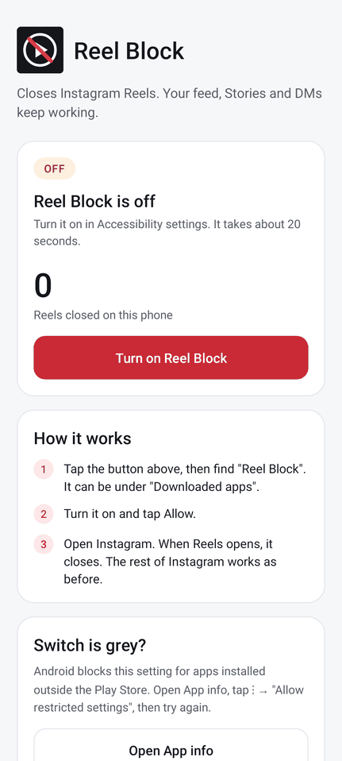
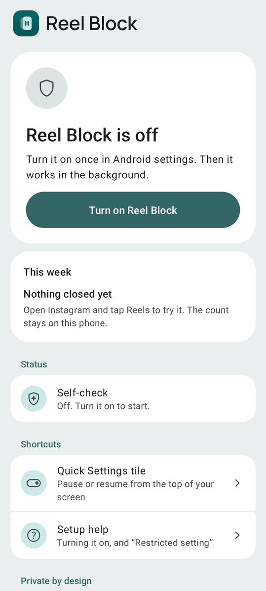
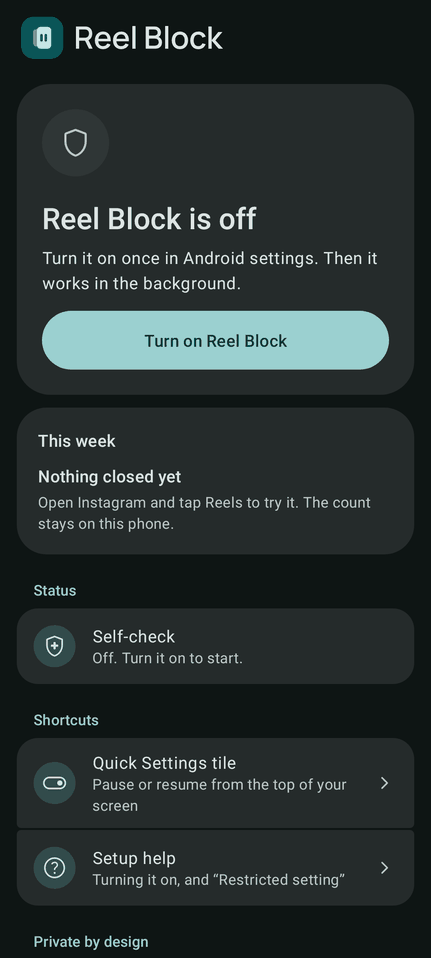
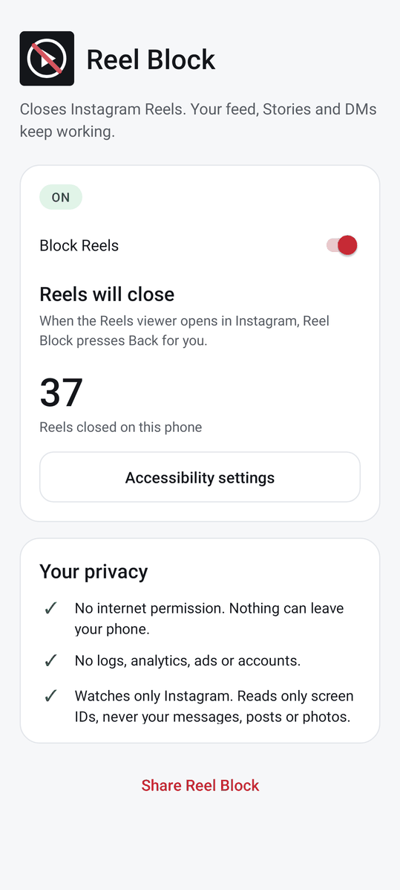
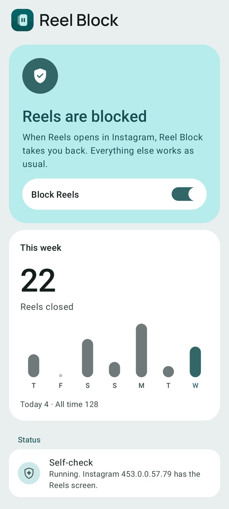
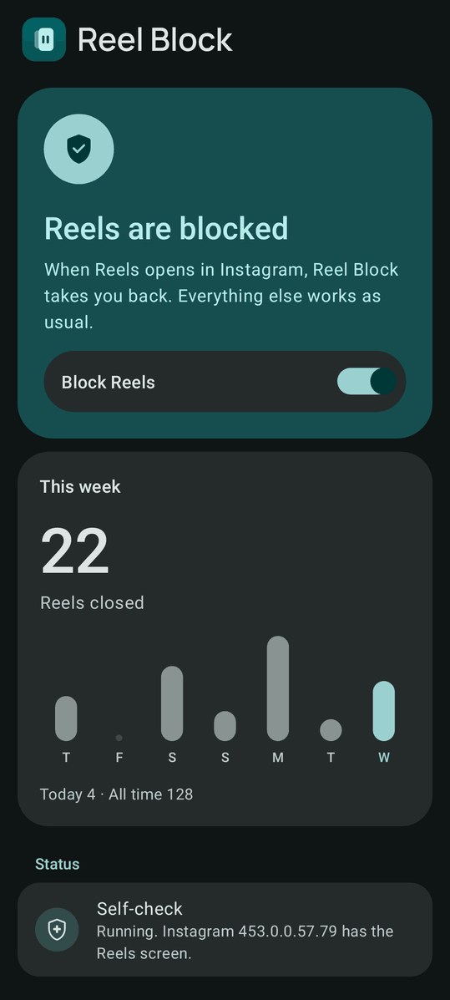
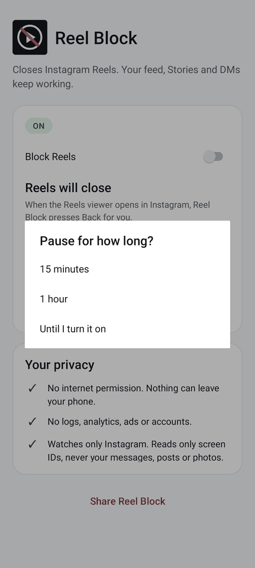
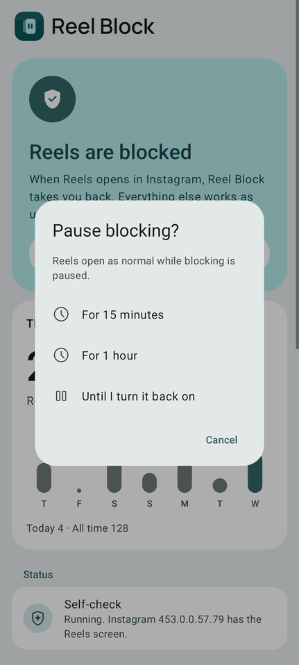
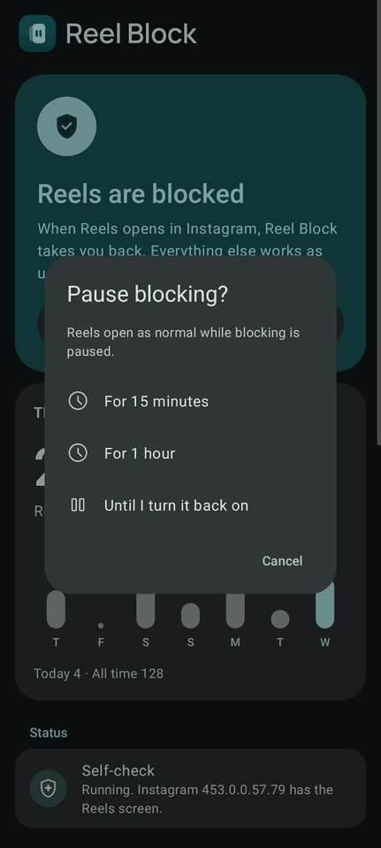
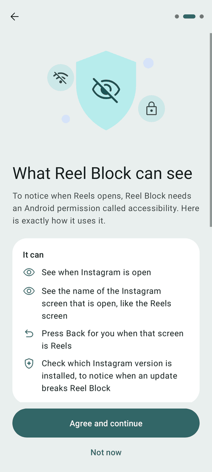

# Reel Block design system

This file documents the design system as it is built. Every value comes from a file in `res/`, `tools/` or `src/`. If this file and a source file disagree, the source file wins: fix this file.

## 1. Goal

A stranger on GitHub must trust Reel Block enough to sideload it and turn on an accessibility permission. So the app must look calm, plain and Pixel-quality, and it must say clearly what it does. The look is Material 3 with some M3 Expressive shapes and motion. It is built only from platform APIs: no AndroidX, no Material Components (MDC). Colours, sizes, type and motion are tokens in `res/values*/`, and layouts may use only tokens.

## 2. Audit of v1.4

Version 1.4 had signals that read as "hacker tool". Each one is replaced.

| Before (v1.4) | After |
|---|---|
| Icon: black square, play button with a red slash (reads as "forbidden", like a warning or malware) | Calm teal squircle with a Reel card on pause in front of a feed card (`res/drawable/ic_launcher_*.xml`), plus a themed monochrome layer for Android 13+ |
| Harsh red accent (#C92A35) on the main button and links | Red only for real problems (error roles). Calm teal brand primary (seed #2C7A7B, `#326667` in light and `#9BD0D0` in dark) that follows the wallpaper on Android 12+ |
| ALL-CAPS letter-spaced status pill "ON/OFF/PAUSED" | Status hero: sentence-case headline, icon badge, state colour |
| Jargon: a button called "Accessibility settings", "screen IDs", "restricted settings" with no context | Plain words. "Accessibility" is explained once, on the disclosure page |
| Everyone sees setup steps and troubleshooting at once, in dense cards | A 3-page first run. Help stays one tap away ("Setup help") |
| Unicode glyphs as icons (✓, ⋮ →, digits in pink circles) | Material Symbols Rounded vectors, tinted by tokens |
| No brand: plain "Reel Block" text | Wordmark (Manrope SemiBold outlines, OFL) and logo mark |
| Platform dialog with square corners and light-only colours | M3 dialog (28dp corners, surface container high, 32% scrim) |
| Grey Material 2 switch | M3 switch (52x32 track, 16/24dp thumb) in a "main switch bar" |
| A lone number "0 Reels closed on this phone" | "This week" card with a 7-day chart, today and all-time counts, and an empty state |
| Bars drawn over a flat window | Edge-to-edge on Android 11+ |

Screenshots. They are rendered from the real layouts with Robolectric native graphics. They are not photos taken on a phone, so fonts and spacing on a real device can differ a little. On Android 12 and newer the colours follow the wallpaper, so another wallpaper gives other colours. The files are in [`docs/screens/`](screens/).

| Screen | Before (v1.4) | After (v2.0, light) | After (v2.0, dark) |
|---|---|---|---|
| Home, off |  |  |  |
| Home, on |  |  |  |
| Pause question |  |  |  |

The first run, page 2 (the disclosure), light: [`after-welcome-2-light.png`](screens/after-welcome-2-light.png). The whole page in one image: [`after-welcome-2-full-light.png`](screens/after-welcome-2-full-light.png).



What is in the folder:

- `before-<screen>-<variant>.png` is v1.4: `home-off`, `home-on`, `home-paused`, `pause`.
- `after-<screen>-<variant>.png` is v2.0: `welcome-1`, `welcome-2`, `welcome-3`, `disclosure-again` (the disclosure opened from home), `home-on`, `home-off`, `home-paused`, `home-stopped`, `home-changed`, `home-empty` and `pause`.
- The variant is `light`, `dark` or `font2` (font scale 2.0). Extra files: `after-home-on-rtl.png`, `after-home-on-small.png`, `after-welcome-2-rtl.png`, `after-welcome-2-small.png` (right-to-left and a small screen), and `after-home-on-android14-light.png` and `after-welcome-3-android14-light.png` (an Android 14 render: wallpaper colours, and the Restricted-setting help on page 3).
- [`audit-android11.txt`](screens/audit-android11.txt) and [`audit-android14.txt`](screens/audit-android14.txt) list every screen state that was rendered, with the number of clickable views in it. Every clickable view has a label and is at least 48dp. Both audits were run with Robolectric.

## 3. Principles

- **One status, one main action.** The home screen opens with the status hero. It has at most one filled button.
- **Tone, not shadows.** Depth comes from surface container tones. Everything sits at elevation level 0.
- **Red means a real problem.** Error roles appear only when Android stopped the service or Instagram changed.
- **Say what it can see, what it keeps and what it never does.** The disclosure page has three cards for this: "It can", "It keeps, only on this phone" and "It never". The home screen repeats it under "Private by design", and its row "What Reel Block can see" opens the disclosure again.
- **Motion is quiet.** Short, eased, and skipped when the user turned on Remove animations.
- **Everything is a token.** No literal dp, sp or hex in layouts or drawables. `tools/check_tokens.py` enforces it.

## 4. Colour

### Two layers

1. **Role tokens** in `res/values/colors.xml` (light) and `res/values-night/colors.xml` (dark). They are Material 3 colour roles from material-color-utilities 0.3.0, scheme TonalSpot, seed **#2C7A7B**, with the primary chroma set to **26** instead of the default 36: calm, not neon. The brand primary is `#326667` in light and `#9BD0D0` in dark. Error is the fixed M3 error palette. Success and warning are custom roles.
2. **Semantic tokens** in `res/values/colors_semantic.xml` and `res/values-night/colors_semantic.xml` (and `res/values-v27/colors_semantic.xml` for the navigation bar). They say what a colour is for. Layouts and code use these, not role names, for surfaces and text.

On Android 12 and newer, `values-v31` and `values-v34` replace the brand roles with wallpaper colours. Error, success, warning, the scrim and the brand mark stay fixed.

**Only roles that a screen uses are defined.** These were removed because no screen used them: `tertiary`, `on_tertiary`, `on_tertiary_container`, `secondary`, `on_secondary`, `inverse_surface`, `inverse_on_surface`, `inverse_primary`, `surface_dim`, `surface_bright`, `surface_container_low`, `success_container`, `on_success_container`, and the semantic token `divider`. They can be generated again from the seed with material-color-utilities (`SchemeTonalSpot`, primary chroma 26) if a screen needs one. Then add the pair to `tools/check_contrast.py`.

### Role tokens

Hex is `#RRGGBB`. The files store opaque colours as `#FFRRGGBB`. This table is printed from the XML files, not typed.

| Group | Role | Light | Dark |
|---|---|---|---|
| Accent | `primary` | #326667 | #9BD0D0 |
| Accent | `on_primary` | #FFFFFF | #003737 |
| Accent | `primary_container` | #B7ECEC | #164E4F |
| Accent | `on_primary_container` | #164E4F | #B7ECEC |
| Accent | `secondary_container` | #CCE8E8 | #324B4B |
| Accent | `on_secondary_container` | #324B4B | #CCE8E8 |
| Accent | `tertiary_container` | #D4E3FF | #344863 |
| Error | `error` | #BA1A1A | #FFB4AB |
| Error | `on_error` | #FFFFFF | #690005 |
| Error | `error_container` | #FFDAD6 | #93000A |
| Error | `on_error_container` | #93000A | #FFDAD6 |
| Surface | `surface` | #F4FBFA | #0E1514 |
| Surface | `surface_container_lowest` | #FFFFFF | #090F0F |
| Surface | `surface_container` | #E9EFEE | #1A2121 |
| Surface | `surface_container_high` | #E3E9E9 | #252B2B |
| Surface | `surface_container_highest` | #DDE4E3 | #2F3636 |
| Surface | `on_surface` | #161D1D | #DDE4E3 |
| Surface | `on_surface_variant` | #3F4948 | #BEC8C8 |
| Surface | `outline` | #6F7979 | #899392 |
| Surface | `outline_variant` | #BEC8C8 | #3F4948 |
| Surface | `scrim` | #000000 | #000000 |
| Custom (success, warning) | `success` | #286A48 | #92D5AB |
| Custom (success, warning) | `on_success` | #FFFFFF | #003920 |
| Custom (success, warning) | `warning` | #7D5700 | #F2BE62 |
| Custom (success, warning) | `on_warning` | #FFFFFF | #422C00 |
| Custom (success, warning) | `warning_container` | #FFDEAA | #5F4100 |
| Custom (success, warning) | `on_warning_container` | #271900 | #FFDEAA |

Success and warning are the M3 "custom colours": they are harmonised toward the seed. Success marks the "It never" icons on the disclosure page (and appears in the welcome illustration). Warning means paused. They are not replaced by dynamic colour. `tertiary_container` and `outline_variant` are used only by the illustrations.

### Semantic tokens

The dark column shows the role the token resolves to in `values-night`. Where the dark file does not list a token, it keeps the light mapping, and the role itself changes between light and dark. Printed from the XML files.

| Token | Light role | Dark role |
|---|---|---|
| `bg_window` | `surface_container` | `surface` |
| `bg_card` | `surface_container_lowest` | `surface_container_high` |
| `bg_dialog` | `surface_container_high` | `surface_container_highest` |
| `text_primary` | `on_surface` | `on_surface` |
| `text_secondary` | `on_surface_variant` | `on_surface_variant` |
| `text_link` | `primary` | `primary` |
| `icon_default` | `on_surface_variant` | `on_surface_variant` |
| `hero_on_bg` | `primary_container` | `primary_container` |
| `hero_on_fg` | `on_primary_container` | `on_primary_container` |
| `hero_on_badge` | `primary` | `primary` |
| `hero_on_badge_icon` | `on_primary` | `on_primary` |
| `hero_paused_bg` | `warning_container` | `warning_container` |
| `hero_paused_fg` | `on_warning_container` | `on_warning_container` |
| `hero_paused_badge` | `warning` | `warning` |
| `hero_paused_badge_icon` | `on_warning` | `on_warning` |
| `hero_off_bg` | `bg_card` | `bg_card` |
| `hero_off_fg` | `on_surface` | `on_surface` |
| `hero_off_badge` | `surface_container_highest` | `surface_container_highest` |
| `hero_off_badge_icon` | `on_surface_variant` | `on_surface_variant` |
| `hero_problem_bg` | `error_container` | `error_container` |
| `hero_problem_fg` | `on_error_container` | `on_error_container` |
| `hero_problem_badge` | `error` | `error` |
| `hero_problem_badge_icon` | `on_error` | `on_error` |
| `chart_bar` | `outline` | `outline` |
| `chart_bar_today` | `primary` | `primary` |
| `chart_empty` | `outline` | `outline` |
| `indicator_active` | `primary` | `primary` |
| `indicator_inactive` | `outline` | `outline` |
| `nav_bar` | `scrim` on Android 8.0, `bg_window` from Android 8.1 (`values-v27`) | `bg_window` |

Brand mark colours are fixed hex values and never dynamic, so the logo stays recognisable. `brand_fg_back` is ARGB `#73BFEFEC` (about 45% opaque). A bool `light_bars` (true in light, false in dark) sets dark or light system-bar icons.

| Token | Value |
|---|---|
| `brand_bg_top` | #00696B |
| `brand_bg_bottom` | #0B5153 |
| `brand_fg` | #BFEFEC |
| `brand_fg_back` | #BFEFEC at about 45% (ARGB `#73BFEFEC`) |
| `brand_glyph` | #0B5153 |

The chart colours and the page dots use `outline` for the quiet part and `primary` for the one that matters (today, the current page), so both reach 3:1 against their background.

`nav_bar` exists because Android 8.0 (API 26) has no light navigation bar: its buttons are always white, so the bar must be dark. From Android 8.1 (`values-v27`) the bar takes the window colour and the buttons follow `light_bars`. In dark mode it is always the window colour.

### Dynamic colour

| Android | Source | Notes |
|---|---|---|
| 8 to 11 (API 26 to 30) | Fixed brand hex above | minSdk is 26 |
| 12 and 13 (API 31 to 33) | `values-v31`, `values-night-v31`: wallpaper shades `system_accent1/2/3_*`, `system_neutral1/2_*` | Shade to tone: tone = 100 − shade / 10 |
| 14 and newer (API 34+) | `values-v34`, `values-night-v34`: Android's own role colours, `system_<role>_light` and `system_<role>_dark` | Same roles as API 31 |

Shade mapping for API 31 to 33:

| Role | Light shade | Dark shade |
|---|---|---|
| `primary` | accent1_600 | accent1_200 |
| `on_primary` | accent1_0 | accent1_800 |
| `primary_container` | accent1_100 | accent1_700 |
| `on_primary_container` | accent1_700 | accent1_100 |
| `secondary_container` | accent2_100 | accent2_700 |
| `on_secondary_container` | accent2_700 | accent2_100 |
| `tertiary_container` | accent3_100 | accent3_700 |
| `surface` | neutral1_10 | neutral1_900 |
| `surface_container_lowest` | neutral1_0 | neutral1_1000 |
| `surface_container` | neutral2_50 | neutral2_900 |
| `surface_container_high` | neutral1_100 | neutral1_800 |
| `surface_container_highest` | neutral2_100 | neutral2_800 |
| `on_surface` | neutral1_900 | neutral1_100 |
| `on_surface_variant` | neutral2_700 | neutral2_200 |
| `outline` | neutral2_500 | neutral2_400 |
| `outline_variant` | neutral2_200 | neutral2_700 |

API 34+ maps each role of the same name to the system colour of the same name, for example `primary` to `system_primary_light` or `system_primary_dark`. The roles that follow the wallpaper are the same 16 on API 31 and API 34: `primary`, `on_primary`, `primary_container`, `on_primary_container`, `secondary_container`, `on_secondary_container`, `tertiary_container`, `surface`, `surface_container_lowest`, `surface_container`, `surface_container_high`, `surface_container_highest`, `on_surface`, `on_surface_variant`, `outline`, `outline_variant`.

These 11 roles never follow the wallpaper: `error`, `on_error`, `error_container`, `on_error_container`, `scrim`, `success`, `on_success`, `warning`, `on_warning`, `warning_container`, `on_warning_container`.

## 5. Type scale

Font is Roboto through the platform families: `sans-serif` is weight 400, `sans-serif-medium` is weight 500. Sizes and line heights are `sp` tokens in `dimens.xml` (`type_<name>`, `type_<name>_lh`). Letter spacing is in `em`: the M3 tracking in sp divided by the size. Base style `Text` sets colour `text_primary`, high-quality line breaking and normal hyphenation.

| Style | Size / line height | Weight (family) | letterSpacing |
|---|---|---|---|
| `Text` (base, same as Body Large) | 16sp / 24sp | 400 (`sans-serif`) | 0.031 |
| `Text.DisplayLarge` | 57sp / 64sp | 400 | -0.004, tabular numbers (`tnum`) |
| `Text.DisplayLarge.Emphasized` | 57sp / 64sp | 500 (`sans-serif-medium`) | -0.004, `tnum` |
| `Text.HeadlineLarge` | 32sp / 40sp | 400 | 0 |
| `Text.HeadlineMedium` | 28sp / 36sp | 400 | 0 |
| `Text.HeadlineMedium.Emphasized` | 28sp / 36sp | 500 | 0 |
| `Text.HeadlineSmall` | 24sp / 32sp | 400 | 0 |
| `Text.TitleMedium` | 16sp / 24sp | 500 | 0.009 |
| `Text.TitleSmall` | 14sp / 20sp | 500 | 0.007 |
| `Text.BodyLarge` | 16sp / 24sp | 400 | 0.031 |
| `Text.BodyLarge.Secondary` | 16sp / 24sp | 400, colour `text_secondary` | 0.031 |
| `Text.BodyMedium` | 14sp / 20sp | 400 | 0.018 |
| `Text.BodyMedium.Secondary` | 14sp / 20sp | 400, colour `text_secondary` | 0.018 |
| `Text.BodySmall` | 12sp / 16sp | 400, colour `text_secondary` | 0.033 |
| `Text.LabelLarge` | 14sp / 20sp | 500 | 0.007 |
| `Text.Section` (parent `Text.TitleSmall`) | 14sp / 20sp | 500, colour `primary` | 0.007 |

A style exists only where a screen uses it. The other M3 sizes (Display Medium and Small, Title Large, Label Medium and Small) stay in `dimens.xml` as `type_*` tokens, so a style can be added later.

**Emphasized styles** (M3 Expressive) keep the size and raise the weight from 400 to 500. We use them only for the moments that matter: the status headline (`HeadlineMedium.Emphasized`) and the week count (`DisplayLarge.Emphasized`). Nothing else is emphasized.

Buttons use the `LabelLarge` appearance at 16sp (`type_title_medium`). Text in dialog buttons is 14sp (`type_label_large`).

## 6. Spacing, shape, elevation, strokes, sizes

### Spacing (4dp grid)

| Token | Value | | Token | Value |
|---|---|---|---|---|
| `space_0` | 0dp | | `space_5` | 20dp |
| `space_0_5` | 2dp | | `space_6` | 24dp |
| `space_1` | 4dp | | `space_8` | 32dp |
| `space_2` | 8dp | | `space_10` | 40dp |
| `space_3` | 12dp | | `space_12` | 48dp |
| `space_4` | 16dp | | `space_16` | 64dp |

`margin_screen` is 16dp (M3 compact window). `gap_group` is 2dp, the gap between grouped list rows.

### Shape

| Token | Value | Used by |
|---|---|---|
| `radius_xs` | 4dp | Inner corners of grouped rows |
| `radius_sm` | 8dp | |
| `radius_md` | 12dp | |
| `radius_lg` | 16dp | |
| `radius_lg_increased` | 20dp (Expressive) | Outer corners of grouped rows |
| `radius_xl` | 28dp | Card, dialog |
| `radius_xl_increased` | 32dp (Expressive) | Status hero |
| `radius_xxl` | 48dp (Expressive) | Defined, not used yet |
| `radius_full` | 999dp | Buttons, switch bar, switch track, page dots |

Whether 20, 32 and 48 are official M3 Expressive tokens is not verified (see `docs/research.md`, section 4).

### Elevation

| Level | Token | Value |
|---|---|---|
| 0 | `elevation_0` | 0dp |
| 1 | `elevation_1` | 1dp |
| 2 | `elevation_2` | 3dp |
| 3 | `elevation_3` | 6dp |
| 4 | `elevation_4` | 8dp |
| 5 | `elevation_5` | 12dp |

**We use tone, level 0.** Only `elevation_0` is used (buttons). Cards and dialogs separate from the background by surface container tone.

### Strokes and state layers

| Token | Value | Used by |
|---|---|---|
| `stroke_thin` | 1dp | Defined, not used yet (the outlined button was removed) |
| `stroke_outline` | 2dp | Switch track edge when off |
| `state_pressed_alpha` | 0.10 | Pressed ripple (`res/color/state_*.xml`) |
| `scrim_alpha` | 0.32 | Dialog dim (`scrim` colour is black) |
| `press_scale` | 0.97 | Press feedback |

### Component sizes

| Token | Value | Token | Value |
|---|---|---|---|
| `touch_target` | 48dp | `badge_hero` | 64dp |
| `button_height` | 48dp | `badge_list` | 40dp |
| `button_height_large` | 56dp | `step_badge` | 28dp |
| `button_padding_h` | 24dp | `dot_size` | 8dp |
| `list_one_line` | 56dp | `dot_active_width` | 24dp |
| `list_two_line` | 72dp | `chart_height` | 96dp |
| `icon_sm` / `icon_md` | 20dp / 24dp | `chart_bar_width` | 20dp |
| `icon_lg` / `icon_xl` | 32dp / 40dp | `chart_empty_size` | 6dp |
| `logo_mark` | 40dp | `illustration_height` / `_width` | 200dp / 280dp |
| `wordmark_height` / `_width` | 22dp / 140dp | `dialog_width_major` / `_minor` | 65% / 95% (fractions) |
| `adaptive_icon` | 108dp | `dialog_inset` | 24dp |
| `switch_track_width` / `_height` | 52dp / 32dp | `switch_thumb_on` / `_off` | 24dp / 16dp |

The dialog width is a share of the screen, not dp: the platform alert dialog values, 65% on wide screens (`dialog_width_major`) and 95% on phones (`dialog_width_minor`). The dialog also keeps `dialog_inset` (24dp) from the screen edge.

## 7. Motion

All durations are `motion_*` integers in `res/values/motion.xml`. All curves are in `res/interpolator/`.

| Token | Value |
|---|---|
| `motion_short2` | 100ms |
| `motion_short3` | 150ms |
| `motion_short4` | 200ms |
| `motion_medium2` | 300ms |
| `motion_medium4` | 400ms |
| `motion_long2` | 500ms |
| `motion_extra_long1` | 700ms |

| Curve | Control points (x1, y1, x2, y2) | Use |
|---|---|---|
| `standard` | 0.2, 0, 0, 1 | Small, utility moves (press down) |
| `emphasized` | Path: `M 0,0 C 0.05,0 0.133333,0.06 0.166666,0.4 C 0.208333,0.82 0.25,1 1,1` | State changes that stay on screen (hero colour) |
| `emphasized_decelerate` | 0.05, 0.7, 0.1, 1 | Things that enter |

**Press feedback** (`res/animator/press.xml`, set on every button): the control scales to 0.97 in 150ms (`standard`), and back to 1 in 200ms (`emphasized_decelerate`). The ripple is the pressed state layer at 10%.

**What animates** (all in `Ui.java`, `WeekChart.java`, `Welcome.java`):

| What | Motion |
|---|---|
| Hero colour change | Background tint, 500ms, `emphasized`. Skipped on first draw |
| Hero first appears | Fade in and rise 16dp, 500ms, `emphasized_decelerate` |
| Status badge pop | Scale from 0.6 to 1 with a small overshoot (`OvershootInterpolator`, 2.2), 500ms. Only when the state changes |
| Week count | Counts up from 0, 700ms, `emphasized_decelerate`. Once, when the screen opens. Skipped for values under 2 |
| Chart bars | Grow from the baseline, 700ms, `emphasized_decelerate`. Once, when the screen opens |
| Onboarding pages | Slide 32dp (`space_8`) from the side they come from, plus fade, 500ms, `emphasized_decelerate`. Mirrored in right-to-left languages |

Every one of these checks `ValueAnimator.areAnimatorsEnabled()` (`Ui.animate()`). If the user turned on Remove animations, the view jumps to its final state.

## 8. Components

Theme: `Theme.ReelBlock` (parent: platform Material Light or Dark `NoActionBar`). The window and the status bar use `bg_window`. The navigation bar uses `nav_bar` (see Semantic tokens: `scrim` on Android 8.0, `bg_window` from 8.1). System-bar icon colour follows `light_bars`. On Android 11 and newer the bars are transparent and the content is drawn behind them (`Ui.edgeToEdge`).

### Buttons

Base style `Button`: pill shape (`radius_full`), minimum 48dp high and wide, 24dp horizontal padding, 12dp vertical padding, 16dp top margin, centred label, no all-caps, elevation 0, press animator, text 16sp.

| Style | Container | Label | Edge | Ripple | Use |
|---|---|---|---|---|---|
| `Button.Filled` | `primary`, **56dp** minimum height | `on_primary` | none | `state_on_primary` | The one main action of a screen |
| `Button.Tonal` | `secondary_container` | `on_secondary_container` | none | `state_on_surface` | A secondary action that still matters ("Open App info") |
| `Button.Text` | none | `primary` | none | `state_primary` | The quietest action ("Not now", "Read the code", "Let us know") |
| `IconButton` | none, round ripple | icon tinted `text_primary` | none | `state_on_surface` | 48dp square, 12dp padding, 24dp icon. Needs a `contentDescription` ("Back") |

States: default and pressed (ripple 10% plus scale 0.97). Accessibility: every button is at least 48dp; contrast pairs 10 (filled), 11 (tonal) and 7 (text) are in the table in section 10.

### Card

`Card`: flat container `bg_card`, 28dp corners, 20dp padding, 12dp top margin, no shadow. In light, `bg_card` (`surface_container_lowest`) is lighter than the window (`surface_container`). In dark it is lighter too (`surface_container_high` on `surface`). Headings inside a card carry `accessibilityHeading`. Text pairs: 2, 5.

### Status hero

`Hero` (parent `Card`): `bg_hero`, 32dp corners, 24dp padding. Anatomy, top to bottom: round badge (`HeroBadge`, 64dp, 16dp padding, hidden from TalkBack), headline (`Text.HeadlineMedium.Emphasized`, 20dp above it, `accessibilityHeading`, **`accessibilityLiveRegion="polite"`**), body (`Text.BodyLarge`), then the action. Colours, icon and text are set in `MainActivity.render()` with an animated tint. Because the headline is a polite live region, TalkBack reads the new headline when the state changes.

| State | Headline | Container / text | Badge / icon | Icon | Action |
|---|---|---|---|---|---|
| On | Reels are blocked | `hero_on_bg` (`primary_container`) / `hero_on_fg` | `hero_on_badge` (`primary`) / `hero_on_badge_icon` | `ic_status_on` | Switch "Block Reels" (on) |
| Paused | Reels are paused | `hero_paused_bg` (`warning_container`) / `hero_paused_fg` | `hero_paused_badge` (`warning`) / `hero_paused_badge_icon` | `ic_status_paused` | Switch "Block Reels" (off) |
| Off | Reel Block is off | `hero_off_bg` (`bg_card`) / `hero_off_fg` | `hero_off_badge` (`surface_container_highest`) / `hero_off_badge_icon` | `ic_status_off` | Filled "Turn on Reel Block" |
| Stopped | Android stopped Reel Block | `hero_problem_bg` (`error_container`) / `hero_problem_fg` | `hero_problem_badge` (`error`) / `hero_problem_badge_icon` | `ic_status_problem` | Filled "Open Accessibility settings" |
| Changed | Instagram has changed | same as Stopped | same as Stopped | `ic_status_problem` | Filled "Get the newest version" and text "Let us know" |

The text button in the Changed state takes the hero text colour (`hero_problem_fg`). Contrast pairs 13 to 16 (text) and 18 to 21 (badge icons).

### List rows (grouped)

`Row` is a 72dp-minimum row (`list_two_line`): 16dp side padding, 12dp top and bottom padding, vertical centre. Rows in a group are 2dp apart (`gap_group`). A group's first row (`Row.Top`) and a lone row (`Row.Single`) have an extra 8dp above them. Section headers (`SectionHeader`, parent `Text.Section`, 24dp above, `accessibilityHeading`) sit between groups.

| Style | Background | Corners (top / bottom) |
|---|---|---|
| `Row.Top` | `bg_row_top` | 20dp / 4dp |
| `Row` (middle) | `bg_row_middle` | 4dp / 4dp |
| `Row.Bottom` | `bg_row_bottom` | 4dp / 20dp |
| `Row.Single` | `bg_row_single` | 20dp / 20dp |

Parts: `RowIcon` (40dp circle, `secondary_container`, 24dp icon in `on_secondary_container`, 16dp end margin), `RowTexts` (title `RowTitle` = `Text.BodyLarge`, supporting text `RowBody` = `Text.BodyMedium.Secondary`), optional `RowTrailing` (24dp `icon_default`, 12dp start margin; chevron or open-in-new). Icons are hidden from TalkBack, so the row is read from its two texts. Clickable rows are `clickable` and `focusable`. Info-only rows are `focusable` but not `clickable`. States: default, pressed (10% ripple). Pairs 2, 5, 22.

### Switch row (main switch bar)

`SwitchRow` (parent `Text.TitleMedium`): a pill (`bg_switch_row`, `bg_card`, `radius_full`) inside the hero, 56dp minimum, 16dp start and 12dp end padding, label at the start, switch at the end. **The whole row is the touch target.** Label: "Block Reels".

| Part | On | Off |
|---|---|---|
| Track 52x32dp | `primary` | `surface_container_highest` with 2dp `outline` edge |
| Thumb | 24dp, `on_primary` | 16dp, `outline` |

Turning the switch off opens the pause dialog. If the user picks nothing, the switch goes back on. Pairs 24, 28 to 30.

### Dialog

`Theme.ReelBlock.Dialog`: M3 basic dialog. Container `bg_dialog` (`surface_container_high` in light, `surface_container_highest` in dark), 28dp corners, 24dp inset from the screen edge, its minimum width is 95% of the screen on a phone and 65% on a wide screen, scrim at 32%. Parts: `Dialog.Title` (`Text.HeadlineSmall`, 24dp padding, `accessibilityHeading`), `Dialog.Body` (`Text.BodyMedium.Secondary`), `Dialog.Option` (`Text.BodyLarge`, 56dp minimum, 24dp side padding, 24dp leading icon in `icon_default`, 16dp gap, pressed ripple), `Dialog.Button` (text button at the end, 14sp). Back, a tap outside, or Cancel all dismiss it, and blocking stays on. Pairs 3, 6, 8, 23.

### Empty state

Inside the "This week" card, while no Reel has ever been closed. It replaces the numbers and the chart. Title `EmptyState.Title` (`Text.TitleMedium`): "Nothing closed yet". One line of `Text.BodyMedium.Secondary`: "Open Instagram and tap Reels to try it. The count stays on this phone." It says what to do and where the data lives.

### Step badge

`Step` (parent `Text.TitleSmall`): a 28dp circle, `primary_container`, number in `on_primary_container`, 12dp end margin. The step sentence next to it carries the meaning, so the badge is hidden from TalkBack. Pair 12.

### Page dots

Built in `Welcome.java` from `drawable/dot`: 8dp circles, 8dp apart. The current page is a 24dp-wide pill (`dot_active_width`) in `indicator_active` (`primary`); the others are `indicator_inactive` (`outline`), so they still reach 3:1 against the window. The container's description is "Page 2 of 3", and the page change is announced. The pill shape, not only colour, shows the current page. Pairs 31 and 32.

### Week chart (`WeekChart.java`)

Seven rounded bars for the last 7 days, today last. Bar width 20dp, chart height 96dp, 8dp between bars and labels. Bar height is relative to the busiest day, with a minimum of the bar width. A day with no Reels shows a 6dp dot (`chart_empty`). Past days use `chart_bar` (`outline`); today uses `chart_bar_today` (`primary`) and a `primary` label. The empty-day dot uses `chart_empty` (`outline`). Labels are the narrow weekday name in `type_label_medium` (follows font scale), colour `text_secondary`. In right-to-left languages the chart is mirrored, so today is on the left. Bars grow in 700ms on first draw.

Accessibility: the chart is one view with one spoken sentence list: "This week. Monday: 2 Reels. … today: 3 Reels." The count above it is read as "5 Reels closed, This week". Pairs 5, 9, 26, 27 and 33.

## 9. Copy rules

- Short sentences. One idea each.
- Everyday words. No "screen IDs", "node", "service" in the UI.
- Explain "accessibility" once, on the disclosure page. Elsewhere, name the Android screen only when pointing to it.
- Say what it can see **and** what it cannot see.
- No blame. The app says what Android did, not what the user did.
- Numbers with units: "For 15 minutes", "about 20 seconds".
- Sentence case. No ALL CAPS.

| Before | After |
|---|---|
| Switch is grey? | Is the switch grey, or does it say “Restricted setting”? |
| Accessibility settings (button) | Turn on Reel Block |
| OFF | Reel Block is off |
| Reads only screen IDs | It checks screen names. It never reads your messages, posts or photos. |
| You broke it | Android stopped Reel Block |

All strings live in `res/values/strings.xml`. The text shown in Android's own Accessibility settings (`service_summary`, `service_description`) must match the disclosure page.

## 10. Accessibility rules

- **Contrast.** Text 4.5:1. Large text, icons and control edges 3:1. `tools/check_contrast.py` checks the pairs below and exits 1 on any failure.
- **Touch targets** are at least 48dp (`touch_target`). Small visuals (the 28dp step badge) are not touchable.
- **Every control is labelled.** Icon-only buttons have a `contentDescription`. Decorative icons are `importantForAccessibility="no"`.
- **Headings are marked** with `accessibilityHeading`: the app bar, section headers, card titles, dialog titles, onboarding titles, the hero headline.
- **Live regions:** the hero headline and the self-check text are `polite`.
- **The chart has one spoken sentence list** (see Week chart).
- **Font scale 200%.** All text is in `sp`; text views wrap and rows use minimum heights, not fixed heights. Test at 200%.
- **Right-to-left.** Layouts use start and end, never left and right. Directional icons are `autoMirrored` (`ic_back`, `ic_back_press`, `ic_chevron`, `ic_open`). The chart and the page slide are mirrored.
- **Small screens.** Design for 360dp wide. Screens scroll; the onboarding buttons stay at the bottom.
- **Reduced motion.** See section 7.

### Contrast pairs

Checked result:

```
35 pairs x 6 colour sets: all pass
```

The 35 pairs below are the `PAIRS` list in `tools/check_contrast.py`, in the same order. The table is printed from the output of `python3 tools/check_contrast.py`, not typed. The Light and Dark columns are the two fixed sets. Four more sets are checked the same way: light and dark for Android 12 to 13, and light and dark for Android 14 and newer. All pass. The last ratio column is the lowest of those four sets. Dynamic colours depend on the wallpaper, so they cannot be read as hex. The script instead resolves each role to a tone. For API 31 to 33 the shade fixes the tone (tone = 100 − shade / 10, and tone is CIE lightness L*). For API 34+ it uses the M3 tone of each role (for example primary 40 in light, 80 in dark). Contrast then follows from the tones, whatever the wallpaper hue. The brand mark pairs (34 and 35 below) use fixed hex in every set.

| # | Text or icon on background | Min | Light | Dark | Lowest in the 4 dynamic sets | Used for |
|---|---|---|---|---|---|---|
| 1 | `text_primary` on `bg_window` | 4.5:1 | 14.70:1 | 14.33:1 | 13.27:1 | body text, app bar wordmark |
| 2 | `text_primary` on `bg_card` | 4.5:1 | 17.11:1 | 11.16:1 | 10.18:1 | card and row titles, switch label |
| 3 | `text_primary` on `bg_dialog` | 4.5:1 | 13.93:1 | 9.57:1 | 9.55:1 | dialog title and options |
| 4 | `text_secondary` on `bg_window` | 4.5:1 | 7.99:1 | 10.81:1 | 8.03:1 | onboarding body, version |
| 5 | `text_secondary` on `bg_card` | 4.5:1 | 9.30:1 | 8.42:1 | 7.72:1 | row supporting text, chart labels |
| 6 | `text_secondary` on `bg_dialog` | 4.5:1 | 7.57:1 | 7.22:1 | 7.24:1 | dialog body |
| 7 | `primary` on `bg_window` | 4.5:1 | 5.58:1 | 10.85:1 | 5.55:1 | section headers, text buttons |
| 8 | `primary` on `bg_dialog` | 4.5:1 | 5.29:1 | 7.24:1 | 5.00:1 | dialog Cancel |
| 9 | `primary` on `bg_card` | 4.5:1 | 6.50:1 | 8.45:1 | 6.46:1 | chart 'today' label |
| 10 | `on_primary` on `primary` | 4.5:1 | 6.50:1 | 7.70:1 | 6.46:1 | filled button label |
| 11 | `on_secondary_container` on `secondary_container` | 4.5:1 | 7.25:1 | 7.25:1 | 7.24:1 | tonal button label, row icons |
| 12 | `on_primary_container` on `primary_container` | 4.5:1 | 7.25:1 | 7.25:1 | 7.24:1 | step numbers |
| 13 | `hero_on_fg` on `hero_on_bg` | 4.5:1 | 7.25:1 | 7.25:1 | 7.24:1 | hero text: on |
| 14 | `hero_paused_fg` on `hero_paused_bg` | 4.5:1 | 13.29:1 | 7.26:1 | 7.26:1 | hero text: paused |
| 15 | `hero_off_fg` on `hero_off_bg` | 4.5:1 | 17.11:1 | 11.16:1 | 10.18:1 | hero text: off |
| 16 | `hero_problem_fg` on `hero_problem_bg` | 4.5:1 | 7.24:1 | 7.24:1 | 7.24:1 | hero text and its text button: stopped / Instagram changed |
| 17 | `on_error_container` on `error_container` | 4.5:1 | 7.24:1 | 7.24:1 | 7.24:1 | self-check problem icon |
| 18 | `hero_on_badge_icon` on `hero_on_badge` | 3.0:1 | 6.50:1 | 7.70:1 | 6.46:1 | hero icon: on |
| 19 | `hero_paused_badge_icon` on `hero_paused_badge` | 3.0:1 | 6.49:1 | 7.74:1 | 6.49:1 | hero icon: paused |
| 20 | `hero_off_badge_icon` on `hero_off_badge` | 3.0:1 | 7.21:1 | 7.22:1 | 7.24:1 | hero icon: off |
| 21 | `hero_problem_badge_icon` on `hero_problem_badge` | 3.0:1 | 6.46:1 | 7.72:1 | 6.46:1 | hero icon: problem |
| 22 | `icon_default` on `bg_card` | 3.0:1 | 9.30:1 | 8.42:1 | 7.72:1 | chevrons, dialog option icons |
| 23 | `icon_default` on `bg_dialog` | 3.0:1 | 7.57:1 | 7.22:1 | 7.24:1 | dialog option icons |
| 24 | `primary` on `bg_card` | 3.0:1 | 6.50:1 | 8.45:1 | 6.46:1 | disclosure 'can' icons, switch track (on) against the switch bar |
| 25 | `success` on `bg_card` | 3.0:1 | 6.47:1 | 8.45:1 | 6.47:1 | disclosure 'never' icons |
| 26 | `chart_bar` on `bg_card` | 3.0:1 | 4.48:1 | 4.56:1 | 4.15:1 | chart bars |
| 27 | `chart_bar_today` on `bg_card` | 3.0:1 | 6.50:1 | 8.45:1 | 6.46:1 | chart bar today |
| 28 | `on_primary` on `primary` | 3.0:1 | 6.50:1 | 7.70:1 | 6.46:1 | switch thumb (on) |
| 29 | `outline` on `surface_container_highest` | 3.0:1 | 3.47:1 | 3.91:1 | 3.47:1 | switch thumb (off) on its track |
| 30 | `outline` on `bg_card` | 3.0:1 | 4.48:1 | 4.56:1 | 4.15:1 | switch track edge (off) against the switch bar |
| 31 | `indicator_active` on `bg_window` | 3.0:1 | 5.58:1 | 10.85:1 | 5.55:1 | page indicator, current page |
| 32 | `indicator_inactive` on `bg_window` | 3.0:1 | 3.85:1 | 5.86:1 | 3.85:1 | page indicator, other pages |
| 33 | `chart_empty` on `bg_card` | 3.0:1 | 4.48:1 | 4.56:1 | 4.15:1 | chart: dot for a day with no Reels closed |
| 34 | `brand_fg` on `brand_bg_bottom` | 3.0:1 | 7.24:1 | 7.24:1 | 7.24:1 | logo: card on teal |
| 35 | `brand_glyph` on `brand_fg` | 3.0:1 | 7.24:1 | 7.24:1 | 7.24:1 | logo: pause bars on the card |

## 11. Brand

### Launcher icon

Adaptive icon (`res/mipmap-anydpi/ic_launcher.xml`): background, foreground, and a monochrome layer. Canvas 108dp, safe zone 66dp (a circle centred on the canvas). Everything sits inside it.

| Part | File | Construction (viewport 108) |
|---|---|---|
| Background | `ic_launcher_bg.xml` | Vertical linear gradient from `brand_bg_top` (y 0) to `brand_bg_bottom` (y 108) |
| Feed card (back) | `ic_launcher_fg.xml` | Rounded rectangle x 35 to 55, y 36 to 72, radius 6, `brand_fg_back` |
| Reel card (front) | `ic_launcher_fg.xml` | Rounded rectangle x 43 to 73, y 31 to 77, radius 8, `brand_fg` |
| Pause bars | `ic_launcher_fg.xml` | Two rounded bars 5 wide, 16 tall, at x 50 to 55 and x 59 to 64, y 46 to 62, `brand_glyph` |
| Monochrome (Android 13+) | `ic_launcher_mono.xml` | Same shapes in white: back card at 45% opacity, front card with the pause bars cut out. The launcher tints it |

Brand colours: `brand_bg_top` #00696B, `brand_bg_bottom` #0B5153, `brand_fg` #BFEFEC, `brand_fg_back` #BFEFEC at about 45%, `brand_glyph` #0B5153. The icon is a card on pause, not a play button, so nothing about it reads as forbidden.

### Other brand assets

- **Logo mark** (`logo_mark.xml`): the launcher icon in a 40dp squircle (radius 12 of 40, the same shape as the launcher's 26 of 88).
- **Wordmark** (`wordmark.xml`): "Reel Block" in Manrope SemiBold as vector outlines, tracking -1%, 140x22dp. Tinted `text_primary`, so it follows light and dark.
- **Quick Settings tile** (`ic_tile_brand.xml`): the card mark in one colour, 24dp; the system tints it.
- **Illustrations** (`ill_welcome`, `ill_privacy`, `ill_setup`): 280x200dp vectors that use role tokens, so they follow dark mode and dynamic colour.

### Licenses

| Asset | License |
|---|---|
| Material Symbols Rounded icons (`ic_*.xml`, except the launcher and tile brand icons) | Apache-2.0, from google/material-design-icons |
| Manrope (wordmark) | SIL Open Font License 1.1. Used as outlines only, no font file ships |
| App code | MIT (`LICENSE`) |

## 12. How to add something

1. **Reuse a token.** Look in `colors_semantic.xml`, `dimens.xml`, `type.xml`, `motion.xml` and `styles.xml` first.
2. **If you need a new one, add it in the right file:**
   - a colour for a purpose: `colors_semantic.xml` (and `values-night/colors_semantic.xml` if it differs in dark);
   - a new colour role (only if a screen uses it): `colors.xml` and `values-night/colors.xml`, generated from the seed with material-color-utilities (`SchemeTonalSpot`, primary chroma 26), then the `values-v31` and `values-night-v31` and `values-v34` and `values-night-v34` files if it should follow the wallpaper;
   - a size, radius, stroke or alpha: `dimens.xml`;
   - a text style: `type.xml`;
   - a duration or curve: `motion.xml` or `res/interpolator/`;
   - a component: a style in `styles.xml` and, if it has a shape or ripple, a drawable.
3. **Never put a literal in a layout or drawable.** No `16dp`, `14sp` or `#RRGGBB`.
4. **Add the new colour pair to `PAIRS`** in `tools/check_contrast.py` when it carries text, an icon or a control edge.
5. **Run both checks and fix failures:**

```
python3 tools/check_contrast.py   # exits 1 if a pair fails
python3 tools/check_tokens.py     # exits 1 if a layout or drawable has a literal value
```

6. **Animate with `Ui`.** Use the motion tokens, and skip the animation when `Ui.animate()` is false.
7. **Write the copy** with the rules in section 9.

## Sources

Material 3 notes, tone tables and links to the androidx token files, MDC docs and Android dynamic colour pages are in [`research.md`](research.md), section 4.
